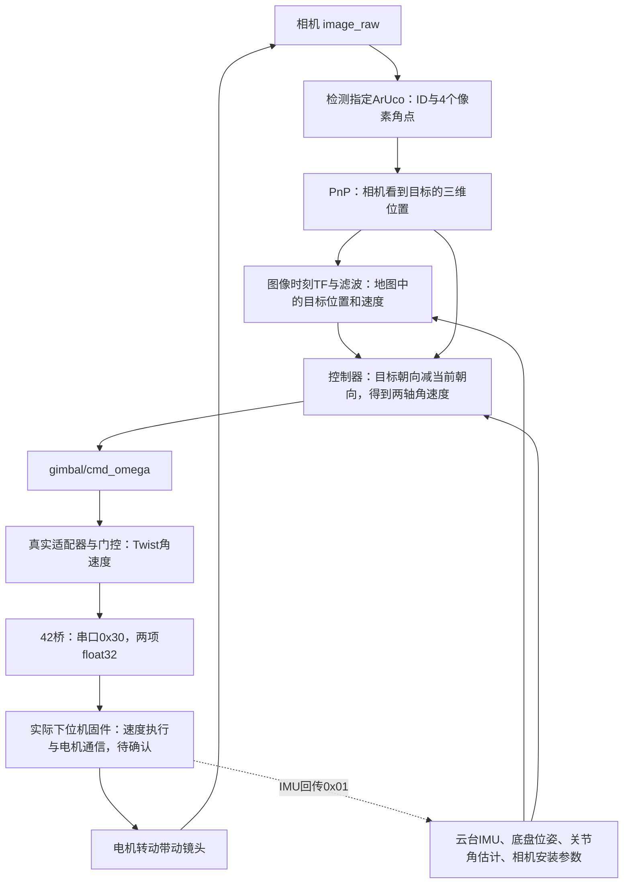

# 云台如何转向目标：源码、数学和现场核查

更新：2026-10-17。本文对应协作仓库e5bd9d0及本地后续增量。**讲清现有程序，不把缺失的下位机固件补成猜测。** 本轮没有启动ROS、打开真实串口、使能电机或刷固件。

**先回答你最关心的问题：上位机根据目标与镜头朝向的偏差，计算yaw、pitch两轴“应该转多快”；串口把两个角速度交给开发板。开发板应再利用速度反馈让电机跟上，但现场固件怎样实现这一步，目前没有源码或版本证据。**

阅读顺序：先看第1～6节理解链路，再看第7～9节分清仿真与实机；到实验室时，B照第10节核查现有进程。当前G方向的实物操作仍用[G专项教程](G坐标定义核查_实际操作.md)，不重复O/C和首次视觉检查。

## 1. 整条链到底分几层

下面实线是当前源码能追到的上位机链；最后一层需要现场固件补证据。图表示设计连接，**不表示这些节点已在NUC同时运行**。



这里存在两种反馈：

- **外层瞄准反馈**：镜头还偏目标多少？上位机把它变成期望角速度。
- **内层速度反馈**：电机/云台实际转得够不够快？开发板及电机驱动器负责执行。它们的算法与上位机PD不是一回事。

串口是NUC与开发板交换字节的通信通道；`/dev/gimbal`只是Linux给某个串口设备起的名字。CAN则是开发板与电机驱动器之间的另一条通信通道。**ROS话题、NUC串口、开发板CAN是三段不同的链路。**

## 2. ArUco识别如何变成“目标在这里”

### 2.1 先决定跟哪个ID

输入是`/image_raw`。检测节点用OpenCV字典`DICT_4X4_50`找码，挑选`perception.target_digit`对应的ID，将四个角点、ID和原图像时间一起发到`/perception/marker_corners`。

例如指定ID=2，画面里同时出现0、1、2、3时，进入这条跟踪链的是2。ID是码图案在字典中的编号，不是靠OCR读取印刷数字。当前启动配置默认ID=-1表示等待指定，不会自动选一个目标；裸节点类的旧默认值是0，现场必须核对实际启动参数。四张实物照片在当前字典下已正确识别为0～3，无需为本教程重拍。

源码：[aruco_detector_node.py](../../src/gimbal_perception/gimbal_perception/aruco_detector_node.py)，`_on_timer()`、`_detect()`、`_pick()`、`_publish()`。节点有运行时目标ID更新逻辑；许多其它参数只在启动时读取，不能假设全部参数都支持热更新。

### 2.2 PnP为什么能从像素算出米

PnP输入：码的四个像素角点、码的真实边长、相机内参K和畸变D。码边长配置为0.10m。它找一个三维位置和姿态，使这个正方形投影到图像后尽量对上四个实测角点。

忽略畸变时，投影关系是：

\[
u=f_xX_O/Z_O+c_x,\qquad v=f_yY_O/Z_O+c_y.
\]

已知码有多大，就能从它在图里有多大估计距离；四个角点还提供倾斜信息。实际代码比较平面PnP候选、尝试精修/回退，再检查正深度、距离范围和重投影误差。输出`/perception/marker_cam`中的`x,y,z`，单位m，表达在相机光学坐标O中。

**图像偏多少像素，不等于电机该转多少度。** 一方面要经过相机模型，另一方面相机与云台的方向、位置和两轴机构关系也必须正确。两份内参仍有冲突，识别出ID不等于测距准确。

源码：[pnp_solver.py](../../src/gimbal_perception/gimbal_perception/pnp_solver.py)的`PnpSolver.solve()`；[marker_pnp_node.py](../../src/gimbal_perception/gimbal_perception/marker_pnp_node.py)的`MarkerPnpNode._on_corners()`。学习对应[主办方第二课：相机模型与PnP](https://blog.secaumene.com/teach/class-2.html)，重点是投影方程和PnP输入输出，不要求先学完BA。

### 2.3 为什么还有坐标转换和滤波

镜头会转。一个静止目标在相机坐标里的数值也会变化，所以不能直接对相机坐标差分就称为“目标世界速度”。当前估计节点在**图像时间**查询`map ← camera_optical_frame`，按

\[
p_M=R_{MO}p_O+t_{MO}
\]

转成地图坐标，再使用已有的平面匀加速卡尔曼滤波估计`x,y,vx,vy,ax,ay`。每轴模型为：

\[
p(t+\Delta t)=p(t)+v(t)\Delta t+\tfrac12a(t)\Delta t^2,\quad
v(t+\Delta t)=v(t)+a(t)\Delta t.
\]

滤波根据位置观测修正这些状态，同时允许加速度变化。输出`/estimation/target_state`中的当前位置、速度和100ms预测位置。缺外参/TF、图像太旧或数据无效时，不用单位矩阵伪造观测。

源码：[target_estimator_node.py](../../src/gimbal_estimation/gimbal_estimation/target_estimator_node.py)的`_drain()/tick()`、[ca_kalman.py](../../src/gimbal_estimation/gimbal_estimation/ca_kalman.py)。学习对应[第三课：状态估计](https://blog.secaumene.com/teach/class-3.html)的预测/观测更新。这里是已有实现，不要求重写滤波器。

**100ms预测是评分输出的一项；它不表示控制器必然瞄准100ms后的点。** 当前参数`control.aim_mode: cur`选择当前位置；`pred`才选择预测位置。控制延迟补偿应由实测延迟决定，不能直接把评分预测时长当成最佳瞄准提前量。

## 3. 当前控制器如何算“应该朝哪里”

当前ROS控制节点只构造`ControlLaw`，走世界坐标计算。它需要：

| 输入 | 来自哪里 | 用途 |
|---|---|---|
| 目标XY与速度 | `/estimation/target_state` | 目标在哪、正在往哪走 |
| 目标高度z与vz | `/perception/marker_cam`辅助通道 | 平面滤波没有z，补出俯仰所需高度 |
| G姿态四元数、三轴gyro | `/gimbal/state` | 当前朝向与当前转动速度 |
| 底盘位姿、连续位姿变化 | `/gimbal/base_pose_raw` | 相机原点运动和底盘自转补偿 |
| map/world变换 | `/gimbal/t_map_world` | 将地图目标换到与IMU一致的参考系 |
| 机械关节角 | `/gimbal/joint_states` | 判断机械限位，不能用惯性yaw代替 |
| 相机安装位置、方向 | 参数 | 从相机中心瞄准，计入安装偏置 |

当前`gimbal_kinematics_node`发布的关节角来自标定模型、同步底盘姿态与IMU的反解，**不是编码器实测反馈**。它只有在安装、零位和IMU参考有效时才可用。

令相机中心到目标的世界向量为`r=(rx,ry,rz)`，水平距离`h=sqrt(rx²+ry²)`。需要朝向：

\[
\psi_t=\operatorname{atan2}(r_y,r_x),\quad
\theta_t=-\operatorname{atan2}(r_z,h).
\]

`ψ`是yaw，`θ`是协议pitch；协议约定低头为正，所以目标在上方时`θt`为负。当前朝向则从四元数旋转矩阵第一列，即G的X轴在world中的方向，算出`ψc,θc`。角误差为`eψ=wrap(ψt−ψc)`、`eθ=θt−θc`。

**这些公式有实际前提：G的X轴与镜头光轴一致、底座接近水平、安装旋转符合模型。G的物理定义现在还未确认，不能据公式反过来宣布实物G朝哪。** 当前world节点也没有完整接入两轴机构中所有移动杠杆臂；一般装配不能只把`world_geometry_verified`改成true便放行。

源码：[gimbal_controller_node.py](../../src/gimbal_control/gimbal_control/gimbal_controller_node.py)的`on_marker()/gimbal_origin_world()/tick()`；[control_law.py](../../src/gimbal_control/gimbal_control/control_law.py)的`target_angles()/current_angles()/compute()`；[gimbal_kinematics_node.py](../../src/gimbal_localization/gimbal_localization/gimbal_kinematics_node.py)的`tick()`。变换原理对应[第一课：刚体变换与TF](https://blog.secaumene.com/teach/class-1.html)，本轮只补G的真实依据，沿用已明确的O/C关系。

## 4. PD和运动前馈究竟各干什么

### 4.1 P：偏得越远，要求转得越快

P项是`Kp × 角误差`。目标在当前朝向左侧，按当前数学约定给正yaw速度；接近目标时误差减小，P要求的速度也减小。`Kp=6`表示误差0.1rad时，P项要求0.6rad/s；不是直接给6度，也不是给电机电流。

### 4.2 前馈：目标在走，视线本身也在转

前馈`f`估计“即使镜头已经瞄准，为继续跟上目标，朝向还得每秒变化多少”。计算使用目标速度减去相机中心的平移速度，防止把本车移动误认为目标移动。

例如目标相对镜头向左横移，即使当前角误差为零，下一瞬间也需要正yaw速度。相机安装在转轴之外时，云台自转还会使相机中心产生`ω × 安装偏移`的平移速度，代码在计算相机原点速度时计入这一项。

对于相对速度`v=(vx,vy,vz)`：

\[
f_\psi=\frac{r_xv_y-r_yv_x}{h^2},\quad
\dot h=\frac{r_xv_x+r_yv_y}{h},\quad
f_\theta=-\frac{h v_z-r_z\dot h}{\|r\|^2}.
\]

这就是对上一节两个`atan2`求时间导数，不是额外的机器学习算法。

### 4.3 D：比较“实际转速”和“跟上目标所需转速”

本工程D项**不直接用相邻图像误差作数值差分**。它使用IMU角速度，并减去视线所需角速度。模型成立时，当前姿态角速度近似为：

\[
m_\psi=g_z/\cos\theta_c,\qquad m_\theta=g_y.
\]

各轴的限幅前输出可以概括为：

\[
u=K_{ff}f+K_pe-K_d(m-f)-b.
\]

其中`b`是底盘自转在该轴上的贡献：yaw用底盘世界z角速度，pitch用底盘角速度在当前G的Y轴上的投影。底盘带着云台转时，关节需要相应补偿。

`−Kd(m−f)`的含义：实际比视线转得快，就减速；实际比视线慢，就补一些速度。静止目标时`f=0`，它表现为阻尼，帮助减少冲过目标。

源码：[control_law.py](../../src/gimbal_control/gimbal_control/control_law.py)的`feedforward()/imu_feedback()/ControlLaw.compute()`。学习对应[第五课：控制理论](https://blog.secaumene.com/teach/class-5.html)中的反馈、P/D与前馈；先弄清每项的单位和方向，无需为此引入MPC。

**配置细节：**纯类默认`ff_gain=1`，但当前[tracker_params.yaml](../../src/gimbal_tracker_bringup/config/tracker_params.yaml)写的是`0`，Kp=6、Kd=0.5。即使`ff_gain=0`，D项仍含`+Kd·f`，因此不能说所有运动速度补偿都关闭了。现场实际值还要核对启动参数。

### 4.4 一个实际算过的例子

这是合成数据演示，**不是实机测量，也不是调参建议**。假设当前yaw=0，目标在左侧10°，视线正以0.1rad/s向左转，IMU给当前yaw转速0.04rad/s，底盘不转：

```text
10° = 0.174533 rad
P项       = 6 × 0.174533             = 1.047198 rad/s
D项       = -0.5 × (0.04 - 0.10)     = 0.030000 rad/s
独立前馈  = 0 × 0.10                = 0
限幅前yaw = 1.077198 rad/s
```

从零开始、控制计算间隔10ms，斜率限制15rad/s²将第一步压到`0.15rad/s`。实际ROS节点第一次tick的dt可能为0，先发无效零；这里展示的是一个有效10ms计算步。适配门控另有起步限制，不能将这行数直接当成电机已达到的转速。

## 5. 从控制计算到ROS角速度消息

控制器约100Hz计算，依次做斜率限制、速度幅值限制、机械软限位、有限性检查。当前初始参数是两轴最大2rad/s、斜率15rad/s²，**不是已针对本机标定的性能指标**。

15rad/s²是正常slew阶段的限制；无效输入停止或软限位可以更快把输出压低，不能把它理解为所有输出变化都保证不超过这一数值。

软限位意思是：接近允许的机械边界时，逐渐减小朝边界方向的速度；反方向脱离边界仍应允许。它不是“看到四元数yaw接近2.8就停”，因为底盘转动也会改变惯性yaw，而电线/机构限位由相对底座的关节角决定。

有效输出是`/gimbal/cmd_omega`，类型`GimbalOmegaCmd`：

```text
header.frame_id: gimbal_link
yaw_omega:       rad/s
pitch_omega:     rad/s，协议低头为正
valid:          是否允许作为本次控制计算结果使用
```

只有节点启动还不够：`control.enabled`、`control.world_geometry_verified`、关节/IMU/底盘/目标/高度新鲜度、坐标变换及几何条件都须通过。缺输入时发布无效零，清除旧速度历史。搜索默认关闭；现有模式选择实际上不会进入独立`coast`分支，不能说已经完整实现丢失后继续跟踪。

源码：[gimbal_controller_node.py](../../src/gimbal_control/gimbal_control/gimbal_controller_node.py)的`tick()/_stop()/_mode_of_age()`、[GimbalOmegaCmd.msg](../../src/gimbal_interfaces/msg/GimbalOmegaCmd.msg)。**无效零消息是上位机的停止请求，不是电机停转或失能反馈。**

## 6. 真实串口分支：这两个数如何交到开发板

### 6.1 先过适配器和门控

真实适配分支是：

```text
/gimbal/cmd_omega
  → hardware_adapter_node / CommandGate（约50Hz）
  → /offboardlink/cmd_vel_gimbal，geometry_msgs/Twist
      angular.z = yaw_omega
      angular.y = pitch_omega
  → C++ robo_bridge（42-gimbal_serial）
  → 串口0x30
```

Twist常用于机器人速度消息；这里借用它的角速度字段，**没有给底盘发线速度**。其它linear分量和angular.x保持0。

适配器默认`control_enabled=false`。它检查IMU、源时间戳和命令，启用后留0.6秒静默；IMU/命令过期会锁存故障、停止转发，需要明确的禁用再启用流程。它不知道实际电机是否使能，也不知道CAN反馈是否正常，所以它发布的`GimbalState.enabled=false/link_state=0`是未知状态的保守占位，不能解释成已读取电机状态。

源码：[hardware_adapter_node.py](../../src/gimbal_serial_bridge/gimbal_serial_bridge/hardware_adapter_node.py)的`on_imu()/on_cmd()/tick()`、[command_gate.py](../../src/gimbal_serial_bridge/gimbal_serial_bridge/command_gate.py)的`enable()/output()`。

### 6.2 C++桥只做传输，不在这里跑电机PID

C++桥默认`subscribe_cmd_vel=false`，不开命令订阅。放行时还要求先收到合格IMU、经过静默期且IMU仍新鲜，随后将`angular.z/y`乘相应指令sign，编码成一帧。它不根据目标图像调电机电流，不知道DM当前控制模式。

0x30完整14字节：

| 字节 | 内容 |
|---|---|
| 0～3 | `AA EE 30 08`：帧头、方向地址、指令号、8字节载荷长度 |
| 4～7 | yaw角速度，float32、小端，rad/s |
| 8～11 | pitch角速度，float32、小端，rad/s |
| 12～13 | 两个协议校验字节 |

前述示例中，门控已就绪、sign均+1，`yaw=0.15,pitch=0`编码为：

```text
AA EE 30 08 9A 99 19 3E 00 00 00 00 5A 25
```

这是离线生成的说明用字节，**本轮没有向任何端口发送**。它不包含ArUco ID、目标XYZ、目标角度、Kp/Kd或CAN ID。开发板不是通过这帧知道“跟踪ID2”，它只接收“两轴按这个角速度转”。

源码：[bridge_node.cpp](../../42-gimbal_serial/src/bridge_node.cpp)的`onCmdVel()`、[protocol.hpp](../../42-gimbal_serial/include/gimbal_serial/protocol.hpp)的`encodeCmd()`。对应[主办方串口协议](https://blog.secaumene.com/kit/protocol.html)及[本地协议](../../protocol/PROTOCOL.md)第4、8、10节，首帧就绪见5.2节；通信基础看[第四课：串口与延迟](https://blog.secaumene.com/teach/class-4.html)。本次在线抓取主办方页面失败，具体字节和公式以本地已保存协议为依据，不冒称已核对网页最新正文。

## 7. 开发板收到以后，已知什么、还不知道什么

### 7.1 协议要求它做的事

本地协议约定：接收和校验0x30，转换指令方向，限幅/机械软限位/斜坡，得到`ωref`；然后计算实际速度`ωmeas`，调用`run_velocity_loop(ωref,ωmeas)`。协议还规定使能、超时减速、松弛、CAN掉线和失控处理。

其速度测量约定为：

\[
\omega_{pitch}=g_y,\quad
\omega_{yaw}=g_z\cos\theta_j-g_x\sin\theta_j.
\]

`θj`是**机械pitch关节角**。俯仰级上的IMU跟着低头后，yaw转动会同时出现在gx和gz里，要投影回yaw轴。因此不能始终直接拿gz当机械yaw转速。底座水平等模型前提仍须成立。

注意这和上位机`gz/cosθc`用途不同：上位机在限定模型下取世界朝向变化率；协议这一步取yaw轴转动分量，不能直接把两式混用。

**移动底盘还存在必须对齐的速度定义。** 例：底盘水平向左转0.2rad/s，yaw关节相对底盘不动、pitch=0。真实IMU的gz仍会是0.2rad/s，按上式得到0.2；但相对底盘的yaw关节速度是0。也就是说，仅用云台IMU，不能自动把底盘带来的转动分离出去。

当前上位机已从输出中减去底盘自转，按相对底盘的关节速度设计；协议将0x30称为关节速度，但速度环反馈写的是上述IMU量。**实际固件是否已扣除底盘运动、或者本来按惯性稳定速度接收，是未确认的接口语义。** 若两端重复补偿或使用不同定义，静止桌面能跟踪，装车转弯后仍可能出错。需要查看现用固件/与提供方核对，不能现在就删掉上位机补偿，也不能宣布现用固件一定有错。

**协议给到这里就调用了一个未展开的速度环函数，没有给出现场PID、DM模式或CAN发送实现。** “协议要求”不等于“当前烧录固件已经实现”。

### 7.2 常见的实现怎样理解

若固件自己做速度PI，它可能采用下面这种结构：

\[
e_\omega=\omega_{ref}-\omega_{meas},\quad
\tau_{cmd}=K_{p\omega}e_\omega+K_{i\omega}\int e_\omega dt.
\]

速度慢了就增加力矩，快了就减小力矩，电机驱动器再通过电流环产生力矩。**这个式子仅解释一种候选结构，不是从你们固件读出的代码，不能用这里的符号推断真实增益。**

也可能固件直接把速度设定值发给DM电机的速度模式，由电机驱动器内部做速度环；也可能用MIT模式中的速度/阻尼项或力矩命令。达妙公开例程明确区分MIT、位置速度和速度模式，说明“收到角速度”并不能唯一确定后面的算法。对应资料：[达妙官方控制例程USAGE](https://github.com/dmBots/motor-control-routine/blob/master/stm32%E4%BE%8B%E7%A8%8B/dm_ctrl%28f4%29-4310_v1.0%20%E8%A3%B8%E6%9C%BA/USAGE.md)的1.1、2.1节；[DM-J4310官方说明书目录](https://github.com/dmBots/DM-J4310-2EC/tree/master/manual)。这些资料解释产品可选模式，不能替代本机固件。

因此目前不能确定：实际板型/固件、每轴电机型号、CAN模式与ID、速度环在哪里、PI/PID增益、摩擦/重力补偿、编码器零位/极性、真实限位和超时参数。协议中提到GM6020/DM-J4310，也不能据此宣布现场两轴型号。

### 7.3 要拿到哪些固件材料，才能把最后一段补齐

B向设备提供方取得**本机实际烧录版本对应**的工程/commit及参数，重点找四处：

1. UART/USB接收：0x30解析后写到哪个变量，单位和sign如何处理。
2. 控制任务：周期、速度反馈来源、`run_velocity_loop`或等价函数的完整实现。
3. 电机发送与接收：DM/其它电机驱动文件、CAN ID、模式选择、反馈解析、使能/失能。
4. IMU安装变换与AHRS、机械零位/限位/watchdog参数；若能提供现用bin版本/哈希，一起记录。

同时明确问清：**0x30要求的是相对底盘关节速度，还是惯性系中的稳定转速？固件怎样处理底盘转动？** 这是上、下位机控制连接的实质问题。

现有`gimbal-edu-tools/README.md`将固件指向独立的`gimbal-edu-firmware`仓库；检查过的本地树没有协议提及的实际固件文件。公开例程可以帮助读代码，但不能拿来替代现用固件，更不要求刷进去。

## 8. 仿真里到底实现了什么

### 8.1 虚拟“电机”没有真实电机的内环

原协作仓库`gimbal-edu-tools/virtual_gimbal/virtual_gimbal/mcu_core.py`的`VirtualMcu._plant_step()`使用一阶速度响应：

\[
\alpha=1-e^{-\Delta t/\tau},\quad
\omega_{new}=\omega+\alpha(\omega_{target}-\omega).
\]

再用平均角速度积分关节角。它模拟“要求转得更快以后，实际速度逐渐跟上”。有模拟上膛、watchdog、限位和失控状态，但没有真实CAN、DM模式、编码器误差、电流/力矩环、重力负载或真实PID。

所以仿真能检验上位机逻辑和符号，不能证明C板用了相同电机算法，也不能证明真实负载下会稳定。

### 8.2 Python桥与真实适配链不是同一条路

旧`include/nodes.launch.py`会启动`vgimbal_bridge_node`，直接订阅`/gimbal/cmd_omega`并约100Hz写串口；它不经过`hardware_adapter_node → Twist → C++42桥`。

特别要分清：这条Python桥在本地链路ACTIVE时，即使命令无效或过期，仍可能持续发**零速度0x30保活**。控制器`enabled=false`不保证这个串口分支不发帧。按协议，零帧也可能触发已上膛电机使能并刷新watchdog，零速度不等于失能。

源码：[vgimbal_bridge_node.py](../../src/gimbal_serial_bridge/gimbal_serial_bridge/vgimbal_bridge_node.py)的`_tx_tick()/_check_imu_watchdog()`、[link_state_machine.py](../../src/gimbal_serial_bridge/gimbal_serial_bridge/link_state_machine.py)。旧全量入口继续保留为历史/仿真参考，不能据名字直接拿到真实串口上跑。

### 8.3 另一个BearingControlLaw是什么

[control_law.py](../../src/gimbal_control/gimbal_control/control_law.py)还包含`BearingControlLaw.compute_bearing()`：在已知相机/G旋转和两关节轴的条件下，将目标视线与镜头光轴的差，通过两轴Jacobian换成角速度。Jacobian表示“每个关节转一点，光轴会朝哪边移动”。

它实现P与前馈，**没有使用D/gyro阻尼输入，也没有接到当前ROS控制节点或真实执行入口**；已有理想两轴离线闭环验证。它仍有安装/零偏假设，不能宣称已经支持任意实物装配。当前讲的PD链是前面world控制分支，不能把两者混为一谈。

## 9. 这套控制代码已经部署了吗

| 环节 | 目前能确认的证据 | 结论 |
|---|---|---|
| 检测→PnP | 首次NUC第4步已通过，日志有有效PnP；后续重试曾报消息类型错误 | 已有现场运行证据；不要求重复O/C |
| world控制算法 | 有`ControlLaw`、ROS节点与离线测试 | 源码已实现；没有本机实际闭环部署证据 |
| 当前`processing.launch.py` | 节点列表没有控制器 | 这个入口本身不会启动PD控制 |
| 当前`hardware_interface.launch.py` | 只启动42桥与adapter；命令订阅与转发默认关闭 | 不是开箱即转的闭环入口 |
| 旧全量`competition/sim`入口 | 包含world控制器和Python串口桥 | 有另一条连接方式；不是当前实机操作入口 |
| 真实0x01与电机反馈 | 旧记录只证明曾打开TTY，随后没有合格云台IMU帧 | 不能确认正确板子、固件、真实控制或电机使能 |
| 下位机速度环 | 只有协议中的函数契约，无现用固件 | 必须拿到固件/版本/参数才能下结论 |

**不能说“算法有了，所以云台已经能跟踪”。目前尚无这条完整实机证据链。** 也不能从仓库默认参数断言现场进程实际参数；它可能来自旧install或其它启动文件。

## 10. 到实验室，B怎样只读核查“到底跑了哪条链”

这些命令在**Windows NoMachine连接的NUC Ubuntu终端**执行。用你们原来已能使用`ros2`的终端；本节不编译、不重启节点、不改参数、不打开串口、不发运动消息。若`ros2`命令不存在，回到已有成功终端，不为本节另装环境。

### 10.1 先看进程和节点

B输入：

```bash
ros2 node list
```

然后：

```bash
ps -eo pid,args | rg 'gimbal_controller|hardware_adapter|vgimbal_bridge|robo_bridge|team47_vision_check'
```

若提示`rg: command not found`，不用安装，改用这一条：

```bash
ps -eo pid,args | grep -E 'gimbal_controller|hardware_adapter|vgimbal_bridge|robo_bridge|team47_vision_check'
```

输出中若有`grep -E ...`自身那一行，将它忽略。

应看什么：

- 只有检测/PnP，没控制器：当前只运行了视觉，不会因为目标出现在图里就自动转。
- 出现`gimbal_controller_node`：只说明进程存在，继续查参数和话题。
- 出现`vgimbal_bridge_node`：是Python直写串口分支，记录它的参数路径/串口，不按真实adapter链解释。
- 出现`hardware_adapter_node`与`robo_bridge`：可能是42真实适配分支，继续核对连接。
- `rg`没输出但`ros2 node list`有节点：保留节点列表，可能进程名不同；不能据进程过滤没命中宣布节点没跑。

若出现重复同名节点，先记录，后续按唯一的完整节点名核对；不在本教程中自行杀进程。下面示例用源码默认节点名，现场有namespace时换成列表中的完整名字。

### 10.2 查询参数，判断只是启动还是允许输出

**只有节点列表确实包含对应节点时**，逐条输入：

```bash
ros2 param get /gimbal_controller_node control.enabled
ros2 param get /gimbal_controller_node control.world_geometry_verified
ros2 param get /gimbal_controller_node control.aim_mode
ros2 param get /gimbal_controller_node control.ff_gain
ros2 param get /hardware_adapter_node control_enabled
ros2 param get /robo_bridge subscribe_cmd_vel
```

预期：当前源码默认几个放行布尔值应为`False`；aim_mode为`cur`，加载tracker_params时ff_gain为0。若输出不同，记下**实际值**，不要改成教程里的值。

若`Node not found`：该默认名字没在跑，返回10.1；若`Parameter not set`或参数不存在：可能是旧版本/不同节点，保存报错。不要为了让查询成功而启动控制节点。

增益、ff_gain等大多在节点构造时缓存，当前没有统一的动态更新回调。以后即使`ros2 param set`返回成功，也不保证已构造控制律立即改变；本节只读，不做参数设置。

### 10.3 查消息有没有接到下一层

B逐条输入：

```bash
ros2 topic info /gimbal/cmd_omega --verbose
ros2 topic info /offboardlink/cmd_vel_gimbal --verbose
ros2 topic info /red_standard_robot1/gimbal --verbose
ros2 topic info /gimbal/joint_states --verbose
```

看`Type`、`Publisher count`、`Subscription count`及具体节点：

| 结果 | 怎么判断 |
|---|---|
| 话题不存在或发布者0 | 这一段没有有效发布源，先记下上游缺哪层；不要先改PD |
| cmd_omega发布者有、订阅者0 | 控制输出没有接入对应桥/adapter |
| cmd_vel发布者有、42桥没订阅 | 命令订阅可能关闭，或者话题名/namespace不一致 |
| 云台IMU有话题 | 仍需一帧实际数据；话题名存在不代表有合格IMU |
| joint_states发布者是kinematics节点 | 是模型派生角，不是电机编码器反馈 |

如果当前**已有**cmd_omega发布者，想看一帧，B输入：

```bash
timeout 5s ros2 topic echo /gimbal/cmd_omega --once --qos-reliability best_effort
```

应看到`header`、`yaw_omega`、`pitch_omega`和`valid`。`valid:false`或零值不能单独定位为PD错误，要结合缺失输入与门控。若5秒没有消息，进程自动结束，记录“有端点、5秒无样本”；若再出现`message type invalid`，这是该终端加载类型支持的问题，保留当时报错和安装prefix，不能据此推翻首次视觉已通过的事实。

若已有Twist发布者，再输入：

```bash
timeout 5s ros2 topic echo /offboardlink/cmd_vel_gimbal --once --qos-reliability best_effort
```

应看`angular.z/y`。看到数字只证明消息发到了ROS层，**不证明串口写成功、固件接收成功或电机照做了**。当前桥也没有从0x01回传完整电机使能/CAN/编码器状态，不能用上位机本地ACTIVE标签代替这些反馈。

### 10.4 查源码安装位置，识别旧install

B输入：

```bash
ros2 pkg prefix gimbal_control
ros2 pkg prefix gimbal_serial_bridge
ros2 pkg prefix gimbal_serial_42
```

应显示包的安装前缀；未安装会报找不到包。把路径与10.1里实际进程命令/参数文件对应起来。**当前终端的prefix不保证另一个早已启动进程使用相同环境**，需要两边证据一致。不要只看本地Git更新就认为NUC运行版本已更新。

B将终端输出复制保存到本队现场记录，A核对每层单位和符号，C补设备标签/连接与现用固件版本资料。此时不安排发角速度试转；真实IMU、G定义、安装/关节零位、限位和实际固件执行链仍是前置条件。

## 11. 这轮离线继续完成了什么

修复`HeightTracker.update()`的一处确定问题：旧代码用“本次原始高度−上次低通高度”求速度，混入了低通滞后。50Hz、8Hz低通、真实匀速上升0.2m/s时，旧输出稳定在约0.315423m/s。

现在改为连续**原始高度**差分，再对高度和速度分别低通；同一输入得到约0.200000m/s。补了正/负匀速、不同采样间隔、静止/停止、重置、无效时间等回归，并验证D项公式与实际adapter的Twist轴映射/协议载荷。

本轮实际检查结果：控制回归18项通过，适配与门控回归13项通过，既有控制单元测试39项通过。它们可能覆盖同一条逻辑，不拼成一个“70项完整系统验收”。C++协议黄金帧/伪终端此前已通过，本轮未重跑；新轴映射测试执行生产adapter方法和Python协议编码，未启动完整ROS/C++桥。

仍需处理的软件限制：

- 高度通道仍用最新IMU/底盘，并限制图像与IMU时间差20ms，没有像XY链一样按图像时刻查历史TF；实际延迟可能使高度一直不可用。本次修复不冒充解决这个问题。
- 只取最短yaw角差，尚未根据机械可达范围选择另一条转动路径。例如当前+2.7rad、目标−2.7rad时可能朝正限位逼近，尽管另一方向存在长路径。
- world控制器与Bearing纯函数各有装配假设，需以真实G/机构参数决定后续接入方案。
- 真实高度噪声、源时间抖动、NUC时限和电机动力学尚未验证。当前高度调用方仍传本机单调时间，未在本轮扩成同步重构。

这些问题已列入待办；没有改控制开关、增益或真实设备设置。先取得真实IMU/G/现用固件证据，再决定具体控制分支与现场试转方案。

本轮测试的命令、输出、修复前后数值与源码哈希见[离线核验记录](云台控制链_离线核验.json)。
