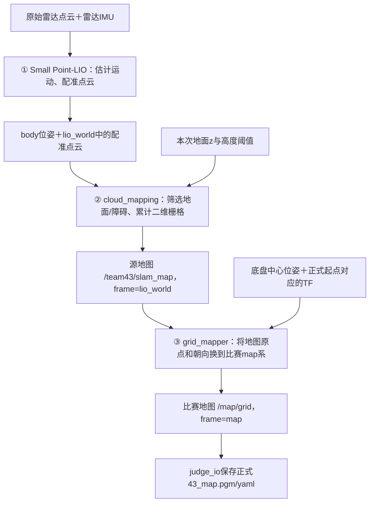

# 底盘定位与点云建图（实机主入口）

本页统一解释本项目的雷达建图链，并保留实机定位、地面点选、源地图保存和比赛地图转换的操作。比赛当天各终端的整体顺序见[比赛启动与收尾](比赛启动与收尾.md)；首次采集外参等材料见[参数文档附录B](未确认参数说明与确认方法.md#附录-b-剩余数据的现场测量与交接)。其余仿真/历史文档的用途统一列在第8节，不需要为了上机先全部读完。

## 0 建图到底做了什么，为什么有好几个名字

雷达每次测到的是周围表面相对自己的三维点。车移动以后，同一面墙会从不同位置被看到；必须先估计传感器的运动，把各次测量放进同一坐标系，才能逐渐画出稳定的环境。

当前项目是一条链，分三个处理环节；不是同时运行三套互相竞争的建图算法：



| 环节 | 怎样理解 | 当前程序/输出 |
|---|---|---|
| ① 定位与点云配准 | 雷达IMU帮助估计运动，点云与已有环境匹配修正位姿；将扫描点换到共同世界系 | `lio.launch.py`：`/red_standard_robot1/aft_mapped_to_init`与`/red_standard_robot1/cloud_registered` |
| ② 二维源地图 | 从三维点中辨认地面和障碍高度，将观察证据累计到俯视网格 | `cloud_mapping.launch.py`：`/team43/slam_map`，可保存`43_slam_map.pgm/yaml` |
| ③ 比赛坐标转换 | 同一张源地图，根据比赛起点变换原点和朝向；不是重新扫描一次场地 | `processing.launch.py`中的`grid_mapper_node`：`/map/grid`，再交提交器保存 |

LIO内部会维护匹配用的空间地图，`cloud_registered`是配准后的点云输出，不是最终二维提交地图，也不表示这个话题就是完整累计三维地图文件。`PointCloud2/CustomMsg`只涉及输入消息格式选择，当前定位算法仍是同一个Small Point-LIO。

### 0.1 三个坐标名不要混淆

| 名称 | 表示什么 | 不应当作什么 |
|---|---|---|
| 原始雷达系 | 厂家定义的点云坐标；用户已确认驱动未变换 | 不是已配准世界系 |
| `body` | LIO使用的雷达内部IMU参考点 | 不是底盘中心 |
| `lio_world` | 本次雷达惯性定位初始化建立的世界参考，名称明确表示LIO世界系 | 不表示RGB相机，也不是比赛起点系 |
| `map` | 以正式比赛起点时的底盘中心和车头方向定义的比赛坐标 | 不能把lio_world改个标签就得到 |

LIO输出、源地图和处理链统一使用`lio_world`，表示雷达惯性定位世界系。

**单独生成源地图可以先做，不需要ArUco、云台B3/B4世界对齐或完整目标定位链。**它需要正确的雷达/内部IMU输入、匹配的内部外参、有效LIO输出和地面确认。整套processing同时处理目标位置，仍要求自己的完整整车配置，不能用“源地图已经能做”替代整车几何依据。

## 1 部署与入口

先按[整体部署](整体部署.md#加载环境)加载ROS、现场Livox环境和本队安装空间。已经按参数文档B0生成本次`现场环境.bash`时，各新终端直接source那条已打印的命令；本页可沿用终端2=LIO、3=源建图、4=操作、5=RViz的分工。已有实例正常运行时复用，不重复启动。

本页不启动雷达驱动，不控制底盘或云台。相机、ArUco尺寸和图像PID不参与源地图的生成。底盘实际运动由主办方/现场人员负责：静止时只能覆盖当前视野，随着允许的运动再增加场地覆盖，不会凭空补齐未看见的区域。

## 2 直接接入已有 PointCloud2 并启动定位

已知输入为`/red_standard_robot1/livox/lidar`（记录为PointCloud2、未变换的原始雷达坐标）和`/red_standard_robot1/livox/imu`（加速度g量级）。接收层自动识别消息类型，按实际字段读取逐点时间，应用固定雷达→内部IMU外参后送入核心，不修改主办方驱动。

在LIO终端加载环境。已有确认过的LIO配置副本时，先将`LIO_CONFIG`设为那份真实文件；否则以下赋值使用安装默认文件。默认文件名不代替设备型号和内部外参依据，尚缺资料时按[参数文档B1](未确认参数说明与确认方法.md#b1-设备型号与内部外参拍照和查型号资料)补齐。

```bash
TRACK_WS="$HOME/team43_ws/rm_task1"
LIO_CONFIG="${LIO_CONFIG:-$(ros2 pkg prefix team43_lio_backend)/share/team43_lio_backend/config/small_point_lio_mid360.yaml}"
ros2 launch team43_lio_backend lio.launch.py \
  params_file:="$LIO_CONFIG" lidar_format:=auto \
  lidar_topic:=/red_standard_robot1/livox/lidar \
  imu_topic:=/red_standard_robot1/livox/imu
```

保持装置静止完成初始化，终端继续运行。操作终端可只看一次：

```bash
ros2 topic echo /red_standard_robot1/aft_mapped_to_init --once \
  --field pose --qos-reliability best_effort
```

应收到pose；frame关系为`lio_world→body`，配准点云输出在`lio_world`中。auto等待发布者时尚未开始定位；类型冲突、字段或时间错误按日志处理，不靠切换主办方驱动解决。

现有`acc_norm=1.0`沿用已知g输入；`satu_acc=3.0`是配置阈值，不是已经测出真实量程。内部`extrinsic_R/T`也不因“驱动未变换”而清零。只在输入/设备配置变化时针对性调整，具体定义见参数文档正文。

## 3 单独启动建图

在源建图终端加载同一环境，`LIO_CONFIG`与正在运行的LIO一致。点云已经在世界系，源建图不会再把它乘一次位姿；它仍需body位姿和雷达偏移计算射线起点。

```bash
TRACK_WS="$HOME/team43_ws/rm_task1"
LIO_CONFIG="${LIO_CONFIG:-$(ros2 pkg prefix team43_lio_backend)/share/team43_lio_backend/config/small_point_lio_mid360.yaml}"
MAP_ROOT="${CONFIRM_DIR:-$TRACK_WS/records}"
mkdir -p "$MAP_ROOT"
MAP_SOURCE_DIR="$MAP_ROOT/source_map_$(date +%Y%m%d_%H%M%S)"
ros2 launch team43_bringup cloud_mapping.launch.py \
  lio_params_file:="$LIO_CONFIG" floor_confirmed:=false \
  output_dir:="$MAP_SOURCE_DIR"
```

已有本次证据目录时地图放在它下面，否则放在本队records下面。保持源建图终端运行，首次“等待地面确认”正常。该节点不需要完整云台TF；缺的是LIO点云/位姿时，先恢复第2节输出。

源地图的处理方式：先按`点z-floor_z`选地面/障碍，再沿雷达射线更新空闲证据，障碍回波更新占用证据；未得到观测证据的格子保持未知。默认每格5cm，20×20m窗口。PGM中通常白色=空闲、黑色=占用、灰色=未知；不是把所有没有点的地方都画白。

## 4 C 在 RViz 点地面 B 录入读到的高度

这是地面点选的唯一详细操作入口，参数文档B5直接引用本节。雷达离地23.1cm（0.231m）只帮助估计地面位置；若LIO初始参考点同高且z朝上，地面约为-0.231m，最终以本次注册点云读数为准。

### 4.1 在RViz显示注册点云

在RViz终端加载环境后执行：

```bash
rviz2
```

1. 在Panels菜单中显示Displays面板；展开Global Options，将Fixed Frame填为`lio_world`。
2. 点击Displays下方Add，添加PointCloud2显示。
3. Topic选`/red_standard_robot1/cloud_registered`，Reliability Policy设为Best Effort。这里不用原始lidar话题。
4. 等待出现点云，用鼠标旋转/缩放视角找到清楚的平地；点太小时调整该显示项的点大小。仍无点先保存RViz Status报错，再看LIO终端是否有输出。
5. 工具栏选择Publish Point；没有该工具时用添加工具按钮加入，Topic使用`/clicked_point`。每点一次若自动退出该工具，再选择一次。

`lio_world`不是水平自动校正的承诺：当前`fix_gravity_direction`估计重力向量，不自动把初始坐标旋转成水平。明显倾斜的地面不能用一个固定z表示。

### 4.2 操作终端保存三个地面点

在空闲操作终端加载环境，运行：

```bash
TRACK_WS="$HOME/team43_ws/rm_task1"
POINT_RECORD_ROOT="${CONFIRM_DIR:-$TRACK_WS/records}"
mkdir -p "$POINT_RECORD_ROOT"
POINT_LOG="$POINT_RECORD_ROOT/floor_points_$(date +%Y%m%d_%H%M%S).txt"
printf '地面点原始记录：%s\n' "$POINT_LOG"
ros2 topic echo /clicked_point | tee -a "$POINT_LOG"
```

暂时不返回提示符正常。在RViz点同一平地的三处，包含一定前后/左右分布，不点墙脚、桌面、车身或空白。每次终端应显示一条`header.frame_id`和`point.x/y/z`；工具只发布诊断点，不发布运动/评分消息。

三条齐后，在**操作终端**按Ctrl+C结束echo，不关闭LIO/源建图/RViz。消息已由tee保存；采样脚本本身不记录`/clicked_point`，这份文件需要交回。

确认frame均为`lio_world`，将三条完整坐标填入[现场记录表B5卡](../记录模板/现场记录表.md#b5地面记录卡)。三个z排序取中间值；例如**假设**为-0.232、-0.230、-0.231，中间值为-0.231m。若z随位置明显变化，先排除误点，再查初始化倾斜/坡道，不强行取中间值确认。

### 4.3 输入实际地面值

首次源建图尚未接受有效扫描时，在操作终端执行，输入实际点选中间值，单位米，保留正负号和小数点：

```bash
read -r -p '输入本次点云地面z（米，填实际中间值）：' FLOOR_Z
ros2 param set /team43/cloud_mapping_node floor_z "$FLOOR_Z"
```

看到`Set parameter successful`后再继续：

```bash
ros2 param set /team43/cloud_mapping_node floor_confirmed true
ros2 topic echo /team43/cloud_mapping/status --once
```

应开始“正在建图”，`accepted_scans`、`n_free`、`n_occupied`随有效扫描更新。单纯有消息或存在发布者不等于地图已经有内容。参数设置失败时停在该步，不能继续设true。

若已接受扫描才发现填错，在源建图终端Ctrl+C，只停本队源建图，再按第3节换新目录重启后重新确认；不在累计地图上混用两个地面高度。更正源地图不要求重启LIO；LIO本身重启后旧地面z则需重新确认。

## 5 看图 保存和判断对不对

RViz再Add一个Map，Topic为`/team43/slam_map`。确认墙体、自由区与未知区对应现场；墙不应随底盘转动长出另一套平行轮廓，未扫区域不应凭空变白。主办方允许的完整运动有助于增加覆盖，地图正确与否不能仅靠静止视野判断。

操作终端手动请求保存：

```bash
ros2 service call /team43/save_slam_map std_srvs/srv/Trigger '{}'
```

应返回`success: true`，message给出实际输出目录。用文件管理器Ctrl+L粘贴该目录，查看`43_slam_map.pgm`和`43_slam_map.yaml`；`MAP_SOURCE_DIR`只在刚才启动源建图的终端中存在，其他终端不会自动获得这个变量。保存失败时保留message，不认为空图已经成功。

默认有更新时每10秒自动保存，正常Ctrl+C退出也保存最后有效源地图。源YAML保留`frame_id: lio_world`和单独的`floor_z`元数据；PGM是栅格图像，YAML提供分辨率、地图原点与朝向，两份需要配套。标准YAML的`origin`第三项是**平面yaw**，不是雷达离地高度。

## 6 从源地图到正式比赛地图，还差什么

源图已经有环境形状，但坐标起点仍是本次LIO参考。正式比赛以起点时刻的底盘中心为原点、初始车头为平面x方向，需要真实`/judge/replay_start`对应的底盘历史位姿来建立`map←lio_world`。

完整链按[比赛启动与收尾](比赛启动与收尾.md)运行`processing.launch.py submission:=true`，其中：

1. `base_pose_provider_node`用雷达IMU到底盘的安装关系换算底盘中心，`map_frame_broadcaster_node`按正式起点建立坐标关系。
2. `grid_mapper_node`订阅`/team43/slam_map`，查询源时间对应的TF，换算栅格原点与平面朝向，保留格子数据、分辨率和源时间，再发布`/map/grid`。
3. 另生成`/map/ray_grid`膨胀图供方向建议使用；它不是最终评分的原始占用图。
4. `judge_io_node`接收`/map/grid`，在正式`judge.output_dir`保存`43_map.pgm/yaml`；同一目录另有`43.csv`。

未开赛时源图正常、比赛图仍等待起点/对应TF，可以是正常状态；不用单位阵或源图改名补结果。B4云台世界对齐服务于目标坐标链，不是源建图前置；当前processing包含整条目标处理链，因此其整车配置门禁仍需按实际依据完成。

### 6.1 为什么看到两套文件，甚至三份副本

| 文件/话题 | 坐标与写出者 | 用途 |
|---|---|---|
| `43_slam_map.pgm/yaml`，`/team43/slam_map` | `lio_world`，cloud_mapping | 源地图、点云建图观察和排错 |
| `grid.out_dir`下的`43_map.pgm/yaml`，`/map/grid` | `map`，grid_mapper | 已转换比赛地图的本队副本 |
| `judge.output_dir`下的`43_map.pgm/yaml`及`43.csv` | 地图为`map`，judge_io | 正式提交产物，按主办方流程收取 |

`grid.out_dir`与正式`judge.output_dir`分开，避免两个写出器争用文件；正式结果以提交器日志和正式目录为准。它们是同一数据链的不同阶段/副本，不是三个SLAM算法。不能拿源图改名充当比赛图，也不要用任意旧文件判断本轮已经保存。

## 7 常见现象与需要调整的参数

| 现象 | 优先看哪里 |
|---|---|
| 有原始点云，没有LIO位姿 | LIO终端的格式、逐点时间、IMU和配置错误；原始驱动输出不等于定位已运行 |
| 有cloud_registered，源图等待地面 | 正常按第4节确认本次floor_z |
| 地面被画成障碍或低障碍漏掉 | floor_z与高度阈值；当前默认障碍高0.15～1.8m、地面容差±0.08m，低于15cm的障碍可能漏掉 |
| 墙随转向出现重影 | 定位/时序/内部外参与运动观测，不能只改二维地图分辨率掩盖 |
| 源图正常，比赛图没有 | processing是否运行、真实起点与对应时刻TF是否建立 |
| 比赛图有，正式文件没更新 | 提交器是否收到图、正式输出目录及其保存错误；不看源地图文件代替 |
| 输入停止后图还在 | 当前保留最后地图；看status中的输入过期状态，不把锁存旧图当持续新数据 |
| 传感器移出地图窗口 | 调整建图配置的width_m/height_m/origin_xy后用新会话源图，不循环覆盖格子 |

建图配置副本来自`team43_grid_mapper/config/cloud_mapping.yaml`。默认分辨率0.05m、窗口20×20m、源原点[-10,-10]；按实际场地覆盖范围和低障碍要求调整，不因默认值存在就认定它们满足本场地。除尚未接受有效扫描时的floor_z/floor_confirmed外，其他尺寸/阈值按启动配置读取，修改后重启源建图并使用新输出目录。

launch的floor_z/floor_confirmed默认值会覆盖YAML；同一LIO会话内再次启动源建图，可在启动命令显式传实测floor_z和true，避免重新点地面。LIO重启、源参考变化或地面关系变化后重新确认。本链采用单一地面高度的近似平地模型，不自动解决显著坡道、楼梯或多层环境。

## 8 其他“建图文档”分别什么时候读

| 文档/入口 | 实际范围 | 什么时候需要 |
|---|---|---|
| **本页** | 实机三阶段关系、启动LIO/源建图、地面点选、保存及比赛图去向 | 理解和操作雷达建图时先看这一页 |
| [比赛启动与收尾](比赛启动与收尾.md) | 云台、LIO、地图、目标处理和提交的整体终端顺序 | 正式运行本轮比赛 |
| [参数文档附录B](未确认参数说明与确认方法.md#附录-b-剩余数据的现场测量与交接) | 型号、安装、B3/B4姿态采样、记录和交接；B5跳转本页 | 首次补现场数据；不再抄一份地面操作 |
| [定位建图仿真](定位建图仿真.md) | 合成已配准点云和已知位姿，验证定位输出之后的ROS接入链；不运行LIO | 快速开发/集成回归 |
| [Gazebo雷达惯性定位仿真](Gazebo雷达惯性定位仿真.md) | 从Gazebo原始雷达/IMU开始，运行实际Small Point-LIO和建图 | 验证定位算法接入及原始传感器链 |
| [Gazebo视觉定位联合仿真](Gazebo视觉定位联合仿真.md) | 在上一条上加入图像、ArUco与世界系目标估计 | 验证移动底盘下的目标坐标与异常恢复 |
| [LIO包说明](../../src/team43_lio_backend/README.md) | 输入协议、auto识别、外参应用和代码边界 | 修改后端或排查接收问题 |
| [SmallPointLIO迁移记录](../记录/SmallPointLIO迁移验证.md)、[稀疏场景失败归因](../记录/Point-LIO稀疏场景失败归因.md) | 历史版本、已运行实验和退化结论 | 追溯依据，不作为当前上机命令 |

另外，`mapping.launch.py`默认`grid_map_source=config`，从`field.yaml`已有几何画栅格，是离线/仿真入口；它不启动雷达/LIO，不会因为名字里有mapping就扫描实物场地。即便切成topic模式，它也只是接图，不代替cloud_mapping生产源地图。当前实机使用`lio.launch.py → cloud_mapping.launch.py → processing.launch.py`，不额外启动这个入口。
